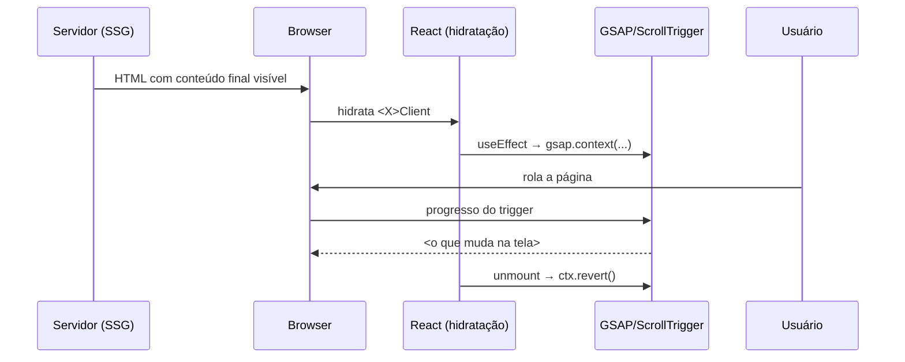

# Fluxo: <nome do fluxo>

**Estado:** <descritivo — bate com o código em `<SHA curto>` | prospectivo —
desenho; o que ainda não existe está marcado com ⛔>

**Uma frase:** <o que este fluxo faz, do gatilho ao efeito observável.>

**Requisitos:** <FR-xx do PRD> · **Pendências relacionadas:** <PEND-xx, ou "nenhuma">

## Atores e onde moram

| Ator | Onde | Papel neste fluxo |
| --- | --- | --- |
| Seção (Server Component) | `src/sections/<X>/index.tsx` | markup, conteúdo, atributos `data-*` |
| Wrapper client | `src/sections/<X>/<X>Client.tsx` | registra e limpa as animações |
| Primitiva de motion | `src/components/motion/<Y>.tsx` | … |
| Presets / hook | `src/animations/presets.ts`, `src/hooks/useReducedMotion.ts` | timings, preferência de movimento |
| Dados | `src/data/<z>.ts`, `src/lib/constants.ts` | … |
| Estilos | `src/app/globals.css`, `tailwind.config.ts` | … |
| <externo> | … | … |

## Sequência — o caminho feliz



Passo a passo, com endereço:

1. <o que acontece> — `src/…` → `<símbolo>`
2. …

## Contratos

Copiados do arquivo real.

```ts
// src/components/motion/<Y>.tsx
interface <Y>Props { … }
```

| Atributo / dado | Onde é definido | Quem consome |
| --- | --- | --- |
| `data-<secao>-<parte>` | `index.tsx` | `<X>Client.tsx` |

## Estados

| Estado | O que o usuário vê | Quem transiciona | Para onde |
| --- | --- | --- | --- |
| Antes da hidratação / sem JS | conteúdo final, sem animação | — | — |
| Reduced motion | conteúdo final, sem animação | `useReducedMotion` | — |
| … | … | … | … |

**Transições impossíveis:** <ex.: "conteúdo invisível" — e o que impede.>

## Invariantes

| Invariante | Onde é garantida | Como se verifica |
| --- | --- | --- |
| Conteúdo nunca depende de animação | … | … |
| Nenhum ScrollTrigger sobrevive ao unmount | `ctx.revert()` em … | … |
| Animação reversível no scroll para cima | `scrub` / `toggleActions` em … | … |

## Modos de falha

| O que falha | O que o sistema faz | O que o usuário vê |
| --- | --- | --- |
| JS não carrega | … | … |
| Resize / rotação no meio da página | … | … |
| … | … | … |

## Decisões

**Decidido** X, **descartado** Y, **porque** Z. Padrão técnico mora na
TECHNICAL-SPEC/ARCHITECTURE; decisão de negócio, num `PEND-xx`.

## Dívidas e pontas soltas

<Violação encontrada ao percorrer o fluxo, com o arquivo, e a tarefa criada no
TASKS.md. "Nada.">

## Histórico

| Data | SHA | O que mudou |
| --- | --- | --- |
| AAAA-MM-DD | <sha> | Documento criado. |
